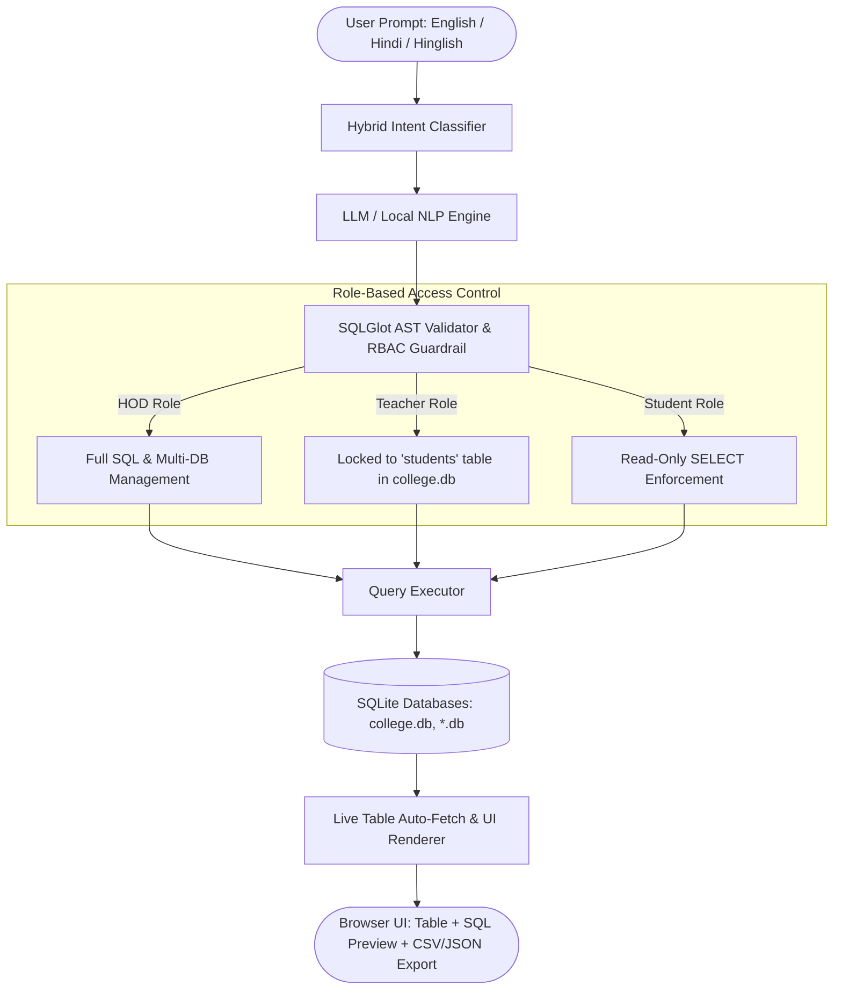

<div align="center">

# 🎓 QueryGenie : AI-Powered Natural Language To SQL System with Clarification Engine
### Multilingual Natural Language-to-SQL College ERP & Clarification Engine

[](https://www.python.org/)
[](https://fastapi.tiangolo.com/)
[](https://www.sqlite.org/)
[](https://github.com/tobymao/sqlglot)
[](LICENSE)

*Manage relational databases without writing a single line of SQL — powered by AI, AST guardrails, and complete multilingual support in English, Hindi, and Hinglish.*

[Features](#-key-features) • [Architecture](#-architecture) • [Getting Started](#-getting-started) • [API & Model Setup](#-llm-configuration-optional) • [Demo Walkthrough](#-demo-queries) • [Tech Stack](#-tech-stack)

---

</div>

## 📌 Problem & Motivation

In traditional College ERP and departmental management systems, non-technical administrators, Head of Departments (HODs), and faculty members often struggle to query or manage records because they don't know SQL syntax.

**QueryGenie** solves this problem by enabling users to perform all database operations (creating databases, tables, inserting records, updating marks, and querying data) using everyday **English, Hindi (Devanagari), and Hinglish prompts** — while strictly enforcing **Role-Based Access Control (RBAC)** at the backend parser level so users cannot access or alter data outside their authorized role.

---

## ⚡ Key Features

- 🌐 **Multilingual Natural Language Processing:**
  - Understands queries in **English** (*"show all students with marks above 85"*), **Hindi** (*"सभी छात्रों का डेटा दिखाओ"*), and **Hinglish** (*"Prem Prajapati ke marks 95 kar do"*).
- 🛡️ **Bulletproof RBAC (SQLGlot AST Guardrail):**
  - **🏛️ HOD (Head of Department):** Full administrative privileges across all databases (Create/Drop DB, Create/Alter/Drop Table, Insert, Update, Delete, Select, View Faculty Salary).
  - **👨‍🏫 Teacher:** Strictly locked to the `students` table in `college.db` (Read & Write: Select, Insert, Update, Delete). Any attempt to access faculty salary, other departments, or meta-databases throws an instant `403 Permission Denied`.
  - **🎓 Student:** Strict Read-Only (`SELECT` only). Write operations and peer private data are completely blocked.
- 🗄️ **Multi-Database Management:**
  - HOD can dynamically create new, isolated SQLite databases (e.g., `PassStudent.db`, `CS_Department.db`) via natural language (`Create new database PassStudent`) and switch between them seamlessly.
- ⚡ **Auto-Fetch on Screen:**
  - Adding or updating data immediately fetches and renders the live table on screen without requiring an extra manual query.
- 👁️ **Transparent SQL Preview:**
  - One-click toggle button to preview the exact SQLite query generated and executed under the hood.
- ⬇️ **One-Click Export:**
  - Export any fetched table to **CSV** (for Excel) or **JSON** with a single click.
- 🎯 **Zero-Hallucination & Clean Start:**
  - Clean schema initialization with **zero dummy data**.
  - Strict validator ensures only user-specified fields are modified or inserted; unspecified values remain `NULL` rather than hallucinated defaults.
- 🔌 **Dual-Engine Execution:**
  - **Local Rule Engine:** Works out-of-the-box with **zero API keys** for standard college operations.
  - **Real LLM Integration:** Connects seamlessly with Google Gemini (Free Tier), Groq LLaMA 3, or OpenAI for complex natural language queries.

---

## 🏗️ Architecture



---

## 🚀 Getting Started

Follow these simple steps to run QueryGenie locally on your system.

### Prerequisites

- **Python 3.10** or higher installed ([Download Python](https://www.python.org/downloads/))
- **Git** installed on your system

---

### Step 1: Clone the Repository

```bash
git clone https://github.com/<your-username>/QueryGenie.git
cd QueryGenie
```

---

### Step 2: Create & Activate a Virtual Environment

#### On Windows (PowerShell):
```powershell
python -m venv venv
.\venv\Scripts\Activate.ps1
```

#### On Linux / macOS:
```bash
python3 -m venv venv
source venv/bin/activate
```

---

### Step 3: Install Dependencies

```bash
pip install -r requirements.txt
```

---

### Step 4: Configure Environment Variables

The project comes with a preconfigured `.env` file that works immediately in **Local Mode** without any API keys.

If you wish to customize settings or connect a real AI model, open `.env`:

```ini
APP_ENV=development
HOST=127.0.0.1
PORT=8000
DATABASE_URL=sqlite:///./college.db

# Default Local Mode (Works without API key):
LLM_API_KEY=mock-key-development

# Query Limits
MAX_RESULT_ROWS=200
QUERY_TIMEOUT_SECONDS=5
```

---

### Step 5: Start the Application

Run the application using:

```bash
python run.py
```

The system will:
1. Initialize the SQLite database schema in `college.db` automatically.
2. Launch the FastAPI server at `http://127.0.0.1:8000`.
3. Automatically open your default web browser to the QueryGenie interface.

---

## 🤖 LLM Configuration (Optional)

While QueryGenie includes a powerful offline local parser, you can unlock full natural language capabilities (complex Hindi/Hinglish reasoning, deep joins, nested subqueries) by plugging in a free or paid LLM API key in `.env`:

### Option A: Google Gemini 2.5 Flash *(Recommended - Free Tier)*
1. Get a free API key from [Google AI Studio](https://aistudio.google.com/).
2. Update your `.env`:
   ```ini
   LLM_API_KEY=your_gemini_api_key_here
   LLM_BASE_URL=https://generativelanguage.googleapis.com/v1beta/openai/
   LLM_MODEL=gemini-2.5-flash
   ```

### Option B: Groq *(Ultra-Fast - Free Tier)*
1. Get a free API key from [Groq Cloud Console](https://console.groq.com/).
2. Update your `.env`:
   ```ini
   LLM_API_KEY=your_groq_api_key_here
   LLM_BASE_URL=https://api.groq.com/openai/v1
   LLM_MODEL=llama-3.3-70b-versatile
   ```

### Option C: OpenAI
```ini
LLM_API_KEY=your_openai_api_key_here
LLM_BASE_URL=https://api.openai.com/v1
LLM_MODEL=gpt-4o-mini
```

---

## 🧪 Demo Queries & Testing Guide

Try these queries in the UI to explore the role hierarchy and natural language engine:

### 1. 🎓 Student Role (Read-Only)
- **Allowed:**
  - `show all students` *(Displays all student records)*
  - `list students with marks greater than 80`
- **Blocked:**
  - `add student "John" marks 90` ❌ *(Throws: "Permission Denied: Students have Read-Only access")*
  - `show all teachers` ❌ *(Faculty salary and sensitive data masked)*

---

### 2. 👨‍🏫 Teacher Role (Student Data Management)
- **Allowed:**
  - `add student "Prem Prajapati" marks 95` *(Inserts record and immediately displays preview)*
  - `Prem Prajapati ke marks 98 kar do` *(Updates marks and fetches updated record)*
  - `show all students`
- **Blocked:**
  - `show all teachers` ❌ *(Throws: "Permission Denied: Teacher sirf 'students' table ka data access kar sakta hai")*
  - `show databases` ❌ *(Meta-commands blocked for faculty)*

---

### 3. 🏛️ HOD Role (Full Control & Multi-Database)
- **Create & Switch Database:**
  - `Create new database PassStudent` *(Creates `PassStudent.db` and switches active DB)*
  - `show databases` *(Lists all databases with table counts and file sizes)*
- **Create Custom Tables:**
  - `create table pass_list with name, marks`
- **Insert & Manage Records:**
  - `add into pass_list "Prem Prajapati" marks 95`
- **Hindi Retrieval:**
  - `sabhi students dikhao`
- **Direct SQL Mode:**
  - Switch to **Direct SQL** mode to write raw SQLite queries with real-time AST validation.

---

## 📂 Project Directory Structure

```text
QueryGenie/
│
├── app/
│   ├── api/
│   │   └── routes.py              # FastAPI endpoints (/query, /databases, /schema, /health)
│   ├── schemas/
│   │   └── request_models.py      # Pydantic request/response schemas
│   ├── services/
│   │   ├── classifier.py          # Hybrid Intent & keyword classifier
│   │   ├── db_manager.py          # Dynamic Multi-Database SQLite manager
│   │   ├── llm_service.py         # Multilingual NLP transliterator & SQL generator
│   │   ├── query_executor.py      # Query execution & live table preview engine
│   │   ├── schema_service.py      # Dynamic schema inspection & DDL provider
│   │   └── sql_validator.py       # SQLGlot AST parser & strict RBAC guardrail
│   ├── config.py                  # Pydantic configuration settings
│   └── main.py                    # FastAPI application instance & static mount
│
├── frontend/
│   ├── index.html                 # Modern responsive ERP console UI
│   ├── style.css                  # Custom clean styling & glassmorphism theme
│   └── script.js                  # Frontend controller (RBAC toggle, preview, export)
│
├── .env                           # Environment configuration file
├── build_querygenie.py             # Single-file reproducible project generator
├── college.db                     # SQLite database file
├── init_db.py                     # Clean schema creator (zero dummy records)
├── requirements.txt               # Python package dependencies
├── run.py                         # One-click startup script with browser launcher
└── README.md                      # Project documentation
```

---

## 🛠️ Tech Stack

| Component | Technology | Purpose |
| :--- | :--- | :--- |
| **Backend API** | [FastAPI](https://fastapi.tiangolo.com/) | High-performance asynchronous REST API framework |
| **SQL AST Parser** | [SQLGlot](https://github.com/tobymao/sqlglot) | AST syntax parsing, SQL validation & RBAC security enforcement |
| **Database ORM** | [SQLAlchemy](https://www.sqlalchemy.org/) | Connection pooling & engine management across multiple SQLite DBs |
| **Database Engine** | [SQLite](https://www.sqlite.org/) | Portable, serverless, zero-configuration local database storage |
| **LLM Orchestration** | [OpenAI Python SDK](https://github.com/openai/openai-python) | Universal client compatible with OpenAI, Gemini, and Groq |
| **Frontend UI** | HTML5, CSS3, Modern ES6 JS | Lightweight, responsive web interface with zero framework overhead |

---

## 🔒 Security & Privacy Guardrails

1. **No Reliance on LLM for Security:** Role-based access control is evaluated using an **Abstract Syntax Tree (AST)** inside Python backend code. Even if an LLM is jailbroken or generates malicious SQL, the backend validator intercepts and blocks unauthorized statements before execution.
2. **Column-Level Masking:** Sensitive columns (e.g., faculty salaries, private contact numbers) are pruned before schema context is provided to the generator or student users.
3. **Prepared Statements & Sanitization:** SQL generation sanitizes inputs to eliminate SQL injection vulnerabilities.

---

## 👥 Contributors

- **Himanshu Prajapati** — Lead Developer & Architecture

---

## 📄 License

This project is licensed under the MIT License — see the [LICENSE](LICENSE) file for details.
